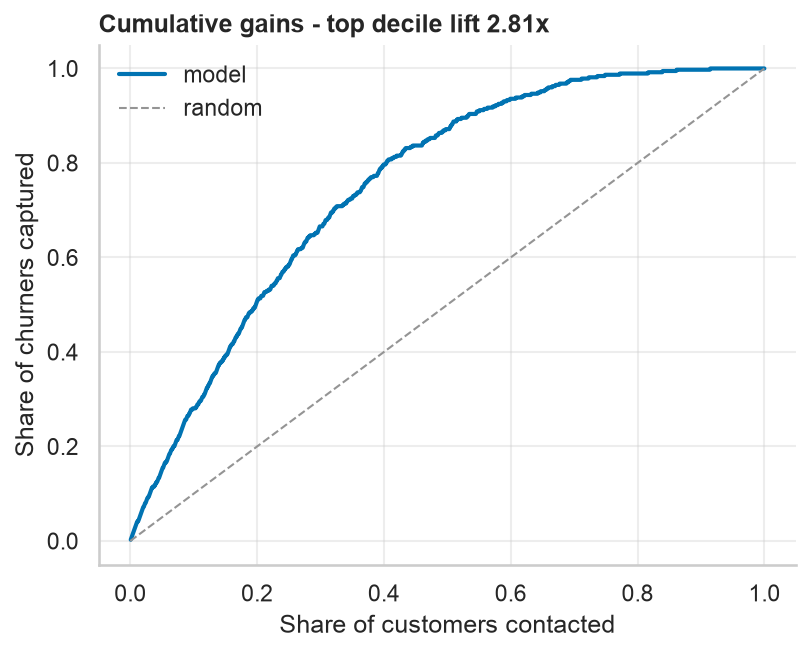
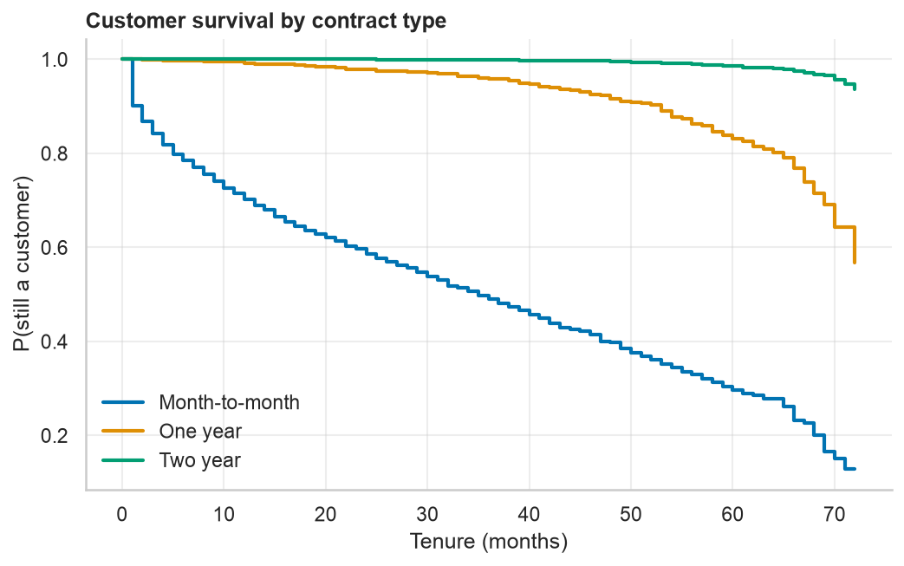
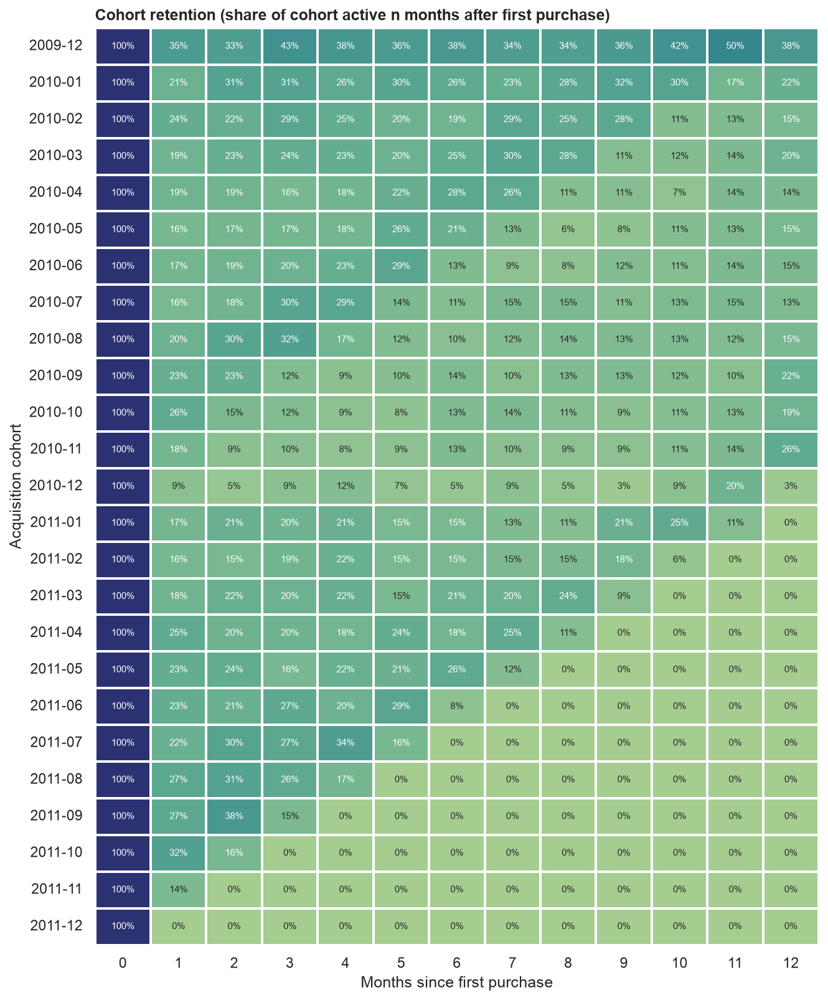

# ChurnLens - Customer Churn Analytics Suite

One tool, five questions about every customer base: **who** will leave, **when**,
**who can be saved**, **which segments** exist, and **what it costs to do nothing**.

Built as a complete data-science project: three public datasets, five modeling lenses,
a leakage-safe scikit-learn pipeline, and a deployable scoring tool with a what-if UI -
prototyped in notebooks, productionized into importable packages (`phase_1` for the
local analytics suite, `phase_2` for the growing production pipeline).

> **Live demo:** _deploy in progress - link coming here_
> **Portfolio:** _[add portfolio link]_

---

## The five lenses

| Lens | Question | Method | Headline result |
|---|---|---|---|
| A - Classification | Who is likely to churn? | HistGradientBoosting (tuned), LogReg + RF baselines | ROC-AUC **0.845**; top-decile lift **2.81x** |
| B - Survival | When will they leave? | Kaplan-Meier, Cox PH, Weibull AFT | C-index **0.86**; a quarter of the base has <=2 expected months left |
| C - Uplift | Who can a campaign actually save? | T-learner (best of 3 meta-learners) | uplift@10% = **44pp** vs +5pp average effect (~9x targeting efficiency) |
| D - Segmentation | What customer groups exist? | K-Means (silhouette-selected k) + RFM | churn 18.6% vs 31.7% across Telco clusters; 4 lifecycle segments in retail |
| E - CLV | What is each customer worth? | BG/NBD + Gamma-Gamma, holdout-validated | MAE ~1 purchase on 6-month holdout; mean 12-mo CLV £1,394 |

**The synthesis:** Revenue-at-Risk = P(churn) x CLV per customer -
**$3.6M** across the 7,043-customer demo base, with 31% of it concentrated
in just 500 customers.

## Results at a glance

Model finds 2.8x more churners than random in the first decile - top two deciles
capture 51% of all churners:



Commitment is the strongest retention lever the business owns - month-to-month
customers churn at 43%, two-year contracts at 3%:



Non-contractual churn is visible without any label - typical retail cohort keeps
~20% of customers one month after first purchase:



## What makes it a tool, not a notebook

- **Schema contracts + validation:** upload any customer file; the tool reports which
  lenses the columns support and exactly what is missing - nothing fails silently.
- **Leakage-safe by construction:** stratified split before any fitting, all
  transformers inside sklearn Pipelines, fitted preprocessors reused at scoring time
  (never refit), survival covariates screened for duration leakage.
- **Cost-aware decisions:** the classification threshold is chosen by a business cost
  matrix (missed churner vs retention offer), not the 0.5 default - and shown to be
  stable across cost assumptions.
- **Falsifiable CLV:** BG/NBD fitted on an 18-month calibration window and validated
  against what customers actually did in the final 180 days.
- **Self-bootstrapping deployment:** a fresh install trains its demo models from the
  public Telco dataset on first boot - no artifacts needed in git.

## Quickstart

```bash
# environment
conda create -n customerchurn python=3.11 -y
conda activate customerchurn
pip install -r requirements.txt

# the app (first boot auto-trains demo models, ~1 min)
streamlit run app/streamlit_app.py

# batch scoring from the CLI
cd Code
python -m phase_1.serving.pipeline score --input your_customers.csv

# retrain on new labeled data
python -m phase_1.serving.pipeline train --data labeled.csv

# run the test suite
python -m pytest tests/ -q   # from the project root
```

Full analysis: run the notebooks in order (`Code/01_...` to `Code/05_...`).
Notebooks 01-02 need the datasets in `Dataset/` (sources below); the MegaFon uplift
dataset downloads itself on first use.

## Repository structure

```
Code/
  01_data_loading.ipynb          # the lab: explore, hit data landmines, fix them
  02_eda_visualization.ipynb     # EDA for all three datasets
  03_feature_engineering_modeling.ipynb   # all five lenses trained
  04_result_analysis.ipynb       # thresholds, lift, error analysis, revenue-at-risk
  05_pipeline_tool.ipynb         # the tool proven on good, broken and foreign data
  phase_1/                       # the local analytics suite (promoted from notebooks)
    config.py
    loader/          data_loader.py
    preprocessing/   features.py
    visualization/   eda.py
    modeling/        models.py, bootstrap.py
    evaluation/      evaluation.py
    serving/         pipeline.py (contracts, validation, scoring, CLI)
  phase_2/                       # the production pipeline (any dataset, staged runs)
    profiling/       profiler.py
    mapping/         mapping.py
    orchestration/   run_manifest.py
tests/                           # one test file per phase_2 module + shared fixtures
app/streamlit_app.py             # ChurnLens UI (what-if + batch scoring)
requirements.txt
```

Workflow convention: every function was prototyped in a notebook first, then promoted
to a package and imported from there - notebooks tell the story, packages ship it.

## Data

| Dataset | Role | Source |
|---|---|---|
| IBM Telco Customer Churn (7,043 x 21) | lenses A, B, D | public IBM sample |
| Online Retail II (~1.07M transactions) | lenses D, E | UCI ML Repository (id 502) |
| MegaFon Uplift (~600K, randomized) | lens C | `sklift.datasets.fetch_megafon` |

Datasets and trained artifacts are intentionally not committed; loaders and the
bootstrap rebuild everything. All results are illustrative of the workflow and
calibrated to these public datasets - production use requires retraining on
business-specific data (`python -m phase_1.serving.pipeline train`).

## Where it goes next

A production design (maintained separately) extends this into a data-agnostic churn
platform: connector-based ingestion (DB/API/files), deterministic profiling with
local-LLM schema mapping (Ollama - data never leaves the machine), a
score/train/explore mode decision per dataset, run manifests with full process
visibility, drift monitoring, and an MCP tool layer so AI agents can operate the
pipeline conversationally.
